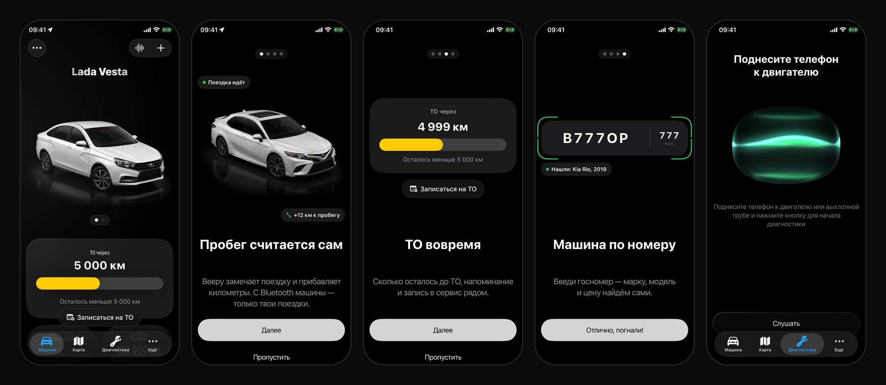
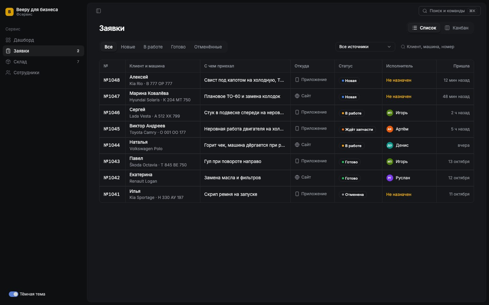

# Beepy

**Дневник машины для iPhone: слушает мотор, сам считает пробег и напоминает про ТО.**

Сделал в одиночку, от идеи до сборки на телефоне: продуктовое исследование,
дизайн-систему в Figma, iOS-приложение, ML на устройстве, бэкенд и веб-CRM для
автосервисов. 26 июля — 15 октября 2026, 226 коммитов.



## Что умеет

- **Диагностика по звуку.** Запись мотора разбирается прямо на телефоне, без
  сети. Сначала привратник отвечает, мотор ли это вообще, потом модель даёт
  калиброванную вероятность неисправности и узлы, на которые стоит посмотреть.
- **Автопробег.** Приложение замечает поездку, даже закрытое, и прибавляет
  километры к пробегу. Привязка к Bluetooth машины — поездки на такси в пробег
  не попадают.
- **ТО.** История с суммами и пробегом, «ТО через N км», напоминание и запись в
  ближайший сервис.
- **Машина по госномеру** — марка, модель, VIN и рыночная цена через свой прокси.
- **Карта** СТО и шиномонтажей на Яндекс Картах.
- **Beepy для бизнеса** — веб-CRM для автосервиса: заявки списком и канбаном,
  склад с расходом по норме, сотрудники, палитра команд ⌘K.



## Что здесь инженерно интересного

1. **Аудиомодель на устройстве.** Пайплайн разбора звука был на Python
   (LAION CLAP + головы [car-diagnosis](https://github.com/adam-s/car-diagnosis)).
   Перевёл его в Core ML: мел-фронтенд в fp32 — у спектра динамический диапазон
   ~200 дБ, fp16 его не держит; энкодер в fp16. Сквозная сверка с сервером на
   одной записи: расхождение 0.0002.
2. **Поездки в фоне без разряженной батареи.** Закрытое приложение будят выход
   из гео-зоны стоянки и «значимое перемещение», CoreMotion отличает машину от
   прогулки, маршрут звука — свою машину от такси. Все решения — чистые
   функции с проверками (`TripAuto`, `TripLink`), а не логика во вью.
3. **Чистый слой как граница архитектуры.** `Core/Pure` собирается отдельно,
   `swiftc` без SwiftUI и SwiftData: 563 проверки идут на любой машине без
   Xcode, а импорт UIKit в логику ломает сборку сразу, а не через неделю.
4. **152-ФЗ с первого дня.** Данные живут на телефоне. Сервер — только там,
   где без него нельзя: платный токен поставщика не попадает в приложение,
   госномер и VIN сервер не хранит, журнал запросов чистится через 90 дней.
   Манифест приватности собран по импортам бинарника, а не по памяти.
5. **Попиксельно к Figma.** Свои утилиты сверки кадра с рендером макета
   (среднее отклонение 6–9 из 255), Liquid Glass с фолбэком до iOS 17, шейдер
   Metal для «облака» прослушивания.
6. **Каталог из 181 кадра машин** — генерация по записанному рецепту с
   бюджетом и скриптами контроля: направление, кадрирование, пол по касанию
   колеса.
7. **Надёжность к выкладке.** Испорченная база восстанавливается, а не роняет
   запуск. Тесты бандла ловят то, за что App Store отклоняет сборку,
   UI-тесты проходят ключевые флоу.

## Как я работаю

- **В паре с AI-агентом, но в инженерных рамках.** Заслонка на коммит не
  пропускает код без записи в журнале и проверяет целостность проекта.
  Решения с причинами — [DECISIONS.md](docs/DECISIONS.md) (100+), грабли как
  механизмы — [TRAPS.md](docs/TRAPS.md) (80), хроника с «как проверено» —
  [JOURNAL.md](docs/JOURNAL.md) (160+ записей).
- **«Работает» — только после проверки:** кадр, замер или тест.
- **Продукт до кода:** дискавери, бенчмаркинг и роадмап B2C и B2B лежат в
  том же Figma-файле, что и дизайн-система.

## Стек

| | |
|---|---|
| iOS | Swift, SwiftUI, SwiftData, iOS 17+, Core ML, CoreLocation, CoreMotion, AVFoundation, App Intents, Metal, Yandex MapKit, XCTest |
| ML | LAION CLAP → Core ML (coremltools), Python-сервер для сверки |
| Бэкенд | TypeScript, Node 22, Hono, Postgres (PGlite в тестах), zod, Docker |
| CRM | React, TypeScript, Vite, Tailwind, shadcn/ui, framer-motion |
| Дизайн | Figma: дизайн-система, макеты, прототипы |

## В цифрах

- iOS — 70 файлов, ~20 тыс. строк Swift; CRM — ~20 тыс. строк TypeScript.
- Проверки: 563 чистого слоя, 15 XCTest (11 юнит и 4 UI), 28 серверных —
  все одной командой `tools/test-all.sh`.

## Запуск

```bash
open Beepy.xcodeproj        # схема AppMVP, ⌘R на симуляторе
tools/test-all.sh           # все проверки; без Xcode — SKIP_XCODE=1
npm --prefix server test    # сервер, Postgres ставить не нужно
npm --prefix crm run dev    # CRM на localhost
```

## Документы

| Файл | Что |
|---|---|
| [CLAUDE.md](CLAUDE.md) | Точка входа: продукт, порядок работы, сборка, минимум проверок |
| [docs/STATE.md](docs/STATE.md) | Состояние компонентов и их дефекты — источник правды после кода |
| [docs/APPSTORE.md](docs/APPSTORE.md) | Готовность к App Store: что сделано, что осталось, тесты |
| [docs/DIAGNOSIS.md](docs/DIAGNOSIS.md) | Разбор звука: модель, пороги, паритет с сервером |
| [docs/BACKEND.md](docs/BACKEND.md) | Сервер и где держать данные в РФ |
| [docs/DECISIONS.md](docs/DECISIONS.md), [docs/TRAPS.md](docs/TRAPS.md), [docs/JOURNAL.md](docs/JOURNAL.md) | Решения, грабли, хроника |

## Автор

Владислав Котырев — [github.com/Vladislavkotyreb](https://github.com/Vladislavkotyreb).
Открыт к предложениям в iOS и продуктовой разработке.
